<p align="center">
  
</p>


# dls

Загрузчики мультимедиа для терминала: YouTube Music, TikTok, SoundCloud.

## Утилиты

| Команда | Описание |
|---------|----------|
| `ytd` | Загрузчик треков/видео с YouTube Music. mp3/mp4, обложка и метаданные, SponsorBlock (по умолчанию вырезает спонсоров, интро/аутро и т.п. — флагом `-sb` отключается). Поддержка плейлистов, cookies (`YTD_COOKIES`), метаданные из любого источника (`-m`). |
| `ttd` | Загрузчик треков/видео с TikTok. mp3 (музыка) и mp4 (видео) с названием и метаданными как на TikTok. Короткие ссылки (`vt./vm.tiktok.com`) резолвит через публичный API. Cookies: `TTD_COOKIES` (default `~/projects/ttd/cookies.txt`, не обязателен). |
| `scd` | Загрузчик треков с SoundCloud. mp3 с обложкой и тегами. Понимает треки, сеты, профили и лайки — качает построчно. Можно вставлять «шаринг» целиком: текст вместе с URL (в шаринге есть `#`, который shell съедает как комментарий — `scd` достанет ссылку из истории команд). Cookies: `SCD_COOKIES` (default `~/projects/scd/cookies.txt`, не обязателен). |

Папки кэша: `~/.cache/ytd`, `~/.cache/ttd`, `~/.cache/scd`. Файлы создаются в текущей папке.

## Установка

```bash
curl -fsSL https://raw.githubusercontent.com/rival-afk/dls/main/install.sh | sh
```

Скрипт покажет список утилит и спросит, что установить. Без вопросов:

```bash
curl -fsSL https://raw.githubusercontent.com/rival-afk/dls/main/install.sh | sh -s -- ytd
curl -fsSL https://raw.githubusercontent.com/rival-afk/dls/main/install.sh | sh -s -- ytd ttd scd
# или всё сразу:
curl -fsSL https://raw.githubusercontent.com/rival-afk/dls/main/install.sh | sh -s -- all
```

Всю техническую работу установщик делает сам:

- ставит зависимости (`bash`, `ffmpeg`, `jq`, `python3`, `yt-dlp`) через доступный пакетный менеджер (`pkg`, `apt`, `dnf`/`yum`, `pacman`, `zypper`, `apk`, `brew`), `yt-dlp` — при отсутствии через `pip`;
- адаптирует шебанг скриптов под текущую систему (Termux → путь Termux, остальные → системный bash);
- кладёт исполняемые файлы в `~/.local/bin` (переопределяется `INSTALL_DIR`) и добавляет её в `PATH` (bash/zsh/profile, fish).

На Windows — отдельный установщик (PowerShell), работает в cmd / PowerShell / Git Bash:

```powershell
irm https://raw.githubusercontent.com/rival-afk/dls/main/install.ps1 | iex
```

Без вопросов (с аргументами при запуске через `iex`):

```powershell
& ([scriptblock]::Create((irm https://raw.githubusercontent.com/rival-afk/dls/main/install.ps1))) ytd scd
# или всё сразу:
& ([scriptblock]::Create((irm https://raw.githubusercontent.com/rival-afk/dls/main/install.ps1))) all
```

Установщик сам:

- кладёт скрипты в `~\.local\bin` (переопределяется `INSTALL_DIR`) и создаёт рядом лаунчеры `ytd.cmd` / `ttd.cmd` / `scd.cmd` — так из cmd/PowerShell команды запускаются, а не открываются в блокноте;
- зависимости ищет в системе: bash (Git Bash — через `git` в PATH или стандартные места), `python3` — в PATH, если его нет, создаёт шим `python3`/`python3.cmd` поверх системного `python`; ffmpeg — в PATH или в `~\.local\share\dls\ffmpeg`; чего в системе не нашлось, скачает с официальных релизов (`jqlang`, `yt-dlp`, `BtbN/FFmpeg-Builds`, `git-for-windows`, `python.org`);
- добавляет `~\.local\bin` в пользовательский PATH и PATH для Git Bash (`~\.bashrc`).

Переменные `INSTALL_DIR`, `APP_DIR`, `BRANCH` работают так же, как в шелл-установщике.

## Автообновление

Скрипты сами обновляются: при каждом запуске сверяются с GitHub (raw, ветка `main`) и, если есть новая версия, подменяют себя на свежую и перезапускаются уже обновлёнными. Отключается переменной `DLS_UPDATE=0`:

```bash
DLS_UPDATE=0 ytd <URL> 1
```

Офлайн обновление не сработает — просто ничего не произойдёт.

## Прочее

- Временные обложки (`.jpg`/`.webp`) скрипты после встраивания в файл удаляют сами; удаление точное — по «снимку» папки до скачивания, чужие картинки в текущей папке не трогаются.

## Использование

```bash
ytd                     # спросит URL и формат (1 — mp3, 2 — mp4)
ytd <URL> 1             # mp3 без некомпозиций (SponsorBlock)
ttd <URL> 2             # mp4 с TikTok
scd <URL>               # mp3 с SoundCloud, можно вместе с текстом шаринга

# Ролики с подпиской/возрастным ограничением — cookies (не обязательно):
# "~/projects/ytd/cookies.txt" по умолчанию или переменная:
YTD_COOKIES=~/cookies.txt ytd <URL> 1
```

Справка: `ytd -h`, `scd -h` (у `ttd` — комментарии в начале скрипта).

## Переменные окружения

| Переменная | По умолчанию | Описание |
|------------|--------------|----------|
| `YTD_COOKIES` | `~/projects/ytd/cookies.txt` | cookies.txt для YouTube (не обязателен, используется только если файл есть) |
| `TTD_COOKIES` | `~/projects/ttd/cookies.txt` | cookies.txt для TikTok |
| `SCD_COOKIES` | `~/projects/scd/cookies.txt` | cookies.txt для SoundCloud |
| `INSTALL_DIR` | `~/.local/bin` | куда установщик кладёт скрипты |
| `BRANCH` | `main` | ветка репозитория для установки |

## Примечания

- SponsorBlock в `ytd` использует только чтение GET `/api/skipSegments` публичного API https://sponsor.ajay.app — ничего не отправляется и не голосуется. Если API недоступен, файл просто скачается без вырезания.
- Cookies (cookies.txt из браузера с расширением типа «Get cookies.txt») нужны только для частных/возрастных роликов — без них обычные скачиваются как есть.
- На macOS достаточно системного `bash`; в Alpine отсутствие `bash` установщик дотянет сам.
